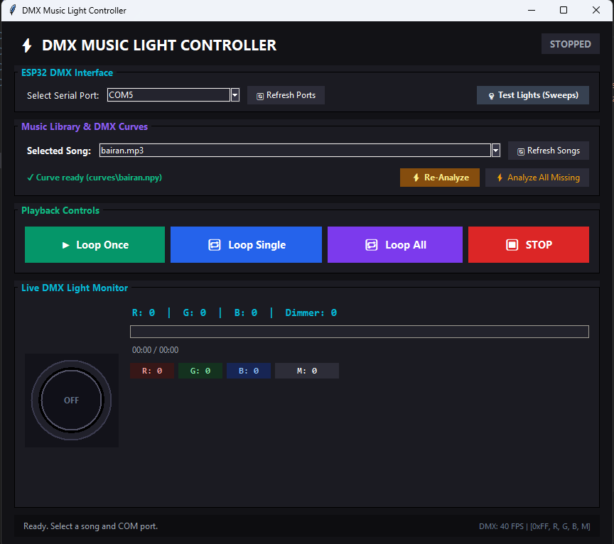

# Audio-Reactive DMX Lights

**Version 2.0: GUI Music Light Controller**

Turn any song into a DMX light show. Each song is analysed once, its light curve is saved, and a desktop GUI plays the song while streaming matching colour and brightness values to an **ESP32 (ESP-WROOM-32)**. The ESP32 converts them to DMX512 through a **TTL-to-RS-485 module** and drives the LED lights.

Beats and the flow of the music drive brightness. Different instruments drive different colours. On every beat one colour takes priority, so red, green and blue never blend into white.



---

## Table of contents

1. [What's new in Version 2](#1-whats-new-in-version-2)
2. [Features](#2-features)
3. [Project summary](#3-project-summary)
4. [How it works](#4-how-it-works)
5. [Hardware](#5-hardware)
6. [Wiring](#6-wiring)
7. [DMX basics used in this project](#7-dmx-basics-used-in-this-project)
8. [Light configuration](#8-light-configuration)
9. [Colour logic](#9-colour-logic)
10. [Repository structure](#10-repository-structure)
11. [Installation](#11-installation)
12. [Using the GUI](#12-using-the-gui)
13. [Adding your own songs](#13-adding-your-own-songs)
14. [Testing and calibration](#14-testing-and-calibration)
15. [Troubleshooting](#15-troubleshooting)
16. [Design decisions](#16-design-decisions)
17. [Limitations](#17-limitations)
18. [Roadmap](#18-roadmap)
19. [Versions](#19-versions)
20. [Author and licence](#20-author-and-licence)

---

## 1. What's new in Version 2

Version 1 played one fixed track. Version 2 turns the project into a complete controller:

| Change | Detail |
|---|---|
| GUI controller | A desktop window to pick the serial port, choose a song and start playback |
| Song dropdown | Put any audio file (`.mp3`, `.wav`, `.ogg`, `.flac`, `.m4a`) in the project folder and it appears in the dropdown automatically |
| Separate curve per song | `analyze.py` saves one curve file per song in `curves/`, so analysis runs only once per song |
| Loop modes | **Loop Once**, **Loop Single** and **Loop All**, plus **STOP** |
| Live monitor | Shows the current R, G, B and dimmer values, a light preview, a progress bar and the elapsed time |
| Test Lights | A sweep test to check the fixture and wiring from the GUI |
| Batch analysis | **Analyze All Missing** analyses every song that has no curve yet; **Re-Analyze** redoes the selected song |
| One-click launch | `run_gui.bat` starts the GUI on Windows |

The original Version 1 code is kept in the **v1.0.0** release.

## 2. Features

- Brightness follows the beats and overall energy of the song.
- Lights stay lit through the whole song and are not dark between peaks.
- RGB colours plus white accents.
- Colours are tied to different instruments or frequency bands.
- One colour wins each beat, so red, green and blue do not mix into white by accident.
- Songs are analysed offline for accuracy, then played back with no real-time analysis load.
- Low-cost hardware: an ESP32 and a TTL-to-RS-485 module, with no commercial DMX interface.

## 3. Project summary

| Item | Detail |
|---|---|
| Purpose | Make LED lights follow the beats, instruments and flow of any song |
| Control protocol | DMX512 |
| Microcontroller | ESP-WROOM-32 (ESP32) |
| DMX line driver | TTL to RS-485 module |
| Reference desk | Next Vmix 2000, 12/24-channel DMX desk |
| Fixtures | LED lights with 3-pin DMX input, address `d001` |
| Computer side | Python 3.12 desktop GUI (Windows), libraries in `requirements.txt` |
| Link to the ESP32 | USB serial (COM port), 40 frames per second |
| Analysis | Offline, one curve file (`.npy`) per song |

## 4. How it works

```
 song.mp3
    |
    v
 analyze.py  --->  curves/song.npy      (done once per song)
                        |
                        v
 gui.py  (pick song, loop mode)  --->  stream.py
                                           |  USB serial, 40 FPS
                                           |  packet: [0xFF, R, G, B, M]
                                           v
                                        ESP32
                                           |  UART (TTL)
                                           v
                                   TTL-to-RS-485 module
                                           |  DMX512
                                           v
                                        LED light
```

### Stage 1: offline analysis (`analyze.py`)

1. Find every hit (onset) in the song.
2. Drop hits that are too close together, keeping the strongest, so a colour stays on long enough to be seen.
3. Listen to the sound of each hit (its low, mid and high make-up) and group similar-sounding hits together automatically using k-means clustering. Deep, bassy hits get the first colour and brighter hits get the later colours.
4. Switch the light to the group's colour at full strength on each hit. The colour stays until the next hit, and the master dimmer gives the punch and fade.
5. Reserve white for the strongest hits during the loudest moments.
6. Make the master dimmer follow loudness and hit strength, and never let it go fully dark.
7. Save the result as `curves/<song name>.npy`. Each frame holds four values (0 to 254): red, green, blue and master dimmer, at 40 frames per second.

If a curve already exists for a song, it is reused. Analysis only runs again when you click **Re-Analyze**. You can also run it from the command line:

```
python analyze.py yoursong.mp3 --plot    # analyse one song and show a graph
python analyze.py --all                  # analyse every audio file in the folder
```

### Stage 2: playback

1. The GUI loads the saved curve for the selected song.
2. The song plays while the GUI streams one packet per frame, at 40 frames per second, over the serial port (115200 baud).
3. Each packet is a `0xFF` header byte followed by the **R, G, B** and **M** (master dimmer) values.
4. The ESP32 reads each packet, builds a full DMX frame and sends it through the RS-485 module.
5. The loop mode decides what happens at the end of the song: stop, repeat the same song, or move to the next song.

### Why offline analysis instead of live analysis?

Analysing the whole song ahead of time is more accurate than real-time analysis, needs no microphone or audio input, gives the same result every time, and keeps playback light on the computer.

## 5. Hardware

| Part | Notes |
|---|---|
| Computer | Windows PC running Python 3.12 |
| ESP-WROOM-32 board | Receives frames over USB serial and generates the DMX signal |
| USB cable | Between the computer and the ESP32 |
| TTL to RS-485 module | Converts the ESP32 UART (TTL) into the differential RS-485 signal DMX uses |
| LED light(s) | 3-pin DMX input, address `d001` |
| 3-pin DMX (XLR) cable | Between the module and the light |
| Next Vmix 2000 | 12/24-channel DMX desk, used as a reference for how the fixture responds |
| Speakers | Play the song from the computer |
| 120 ohm resistor (recommended) | DMX line termination at the last fixture |

## 6. Wiring

```
ESP32 (ESP-WROOM-32)          TTL-to-RS485 module           DMX light (3-pin)
------------------            -------------------           -----------------
TX (UART TX pin)  ---------->  DI
3V3 / 5V          ---------->  VCC
GND               ---------->  GND  ------------------------ Pin 1  (shield / GND)
GPIO (DE/RE) or tied high --->  DE + RE (joined together)
                               B (Data+) ------------------- Pin 3  (Data +)
                               A (Data-) ------------------- Pin 2  (Data -)
```

Notes:

- **DE and RE** are joined and held high so the module always transmits. Many modules do this automatically; check the board.
- **A/B labelling varies** between modules. If the light does not respond, swap A and B.
- **RX is unused.** DMX is send-only.
- Use a common ground between the ESP32, the module and the fixture.
- Add a 120 ohm termination resistor between pin 2 and pin 3 at the last fixture on long runs.
- Use the TX pin that `dmx_esp32.ino` is configured for, and avoid boot strapping pins if you change it.

DMX 3-pin XLR pinout:

| Pin | Signal |
|---|---|
| 1 | Ground / shield |
| 2 | Data - |
| 3 | Data + |

## 7. DMX basics used in this project

- DMX512 sends up to 512 channels, each with a value from 0 to 255.
- Serial format: **250,000 baud, 8 data bits, no parity, 2 stop bits (8N2)**.
- Each frame starts with a **break** (line held low), then a **mark-after-break**, then a **start code of 0**, then the channel values.
- Frames are sent continuously. Fixtures hold the last values they receive.
- DMX uses differential RS-485 signalling, which is why the TTL-to-RS-485 module is needed. The ESP32 cannot drive DMX directly.

The link from the computer to the ESP32 is a separate USB serial connection and is not DMX.

## 8. Light configuration

| Setting | Value |
|---|---|
| DMX address | `d001` (start channel 1) |
| Connector | 3-pin DMX input |
| Channel 1 | Red |
| Channel 2 | Green |
| Channel 3 | Blue |
| Channel 7 | Master dimmer |

Verification test: setting channels 1, 2 and 3 to 255 produced white light, and sweeping the master dimmer faded it in and out. This confirmed the RGB layout and the dimmer channel. The **Test Lights (Sweeps)** button in the GUI repeats this kind of sweep.

> If you use a different fixture, run the sweep test and update the channel map in the ESP32 sketch.

## 9. Colour logic

Early versions mixed every band straight into red, green and blue. Several bands were usually active together, so all three channels stayed high and the lights looked white all the time. The current logic fixes that. It works on the **type of each hit** rather than on separate bands:

1. **Sound type to colour.** Similar-sounding hits are grouped automatically, and each group gets its own colour (red, green or blue). Deep, bassy hits take the first colour.
2. **One pure colour at a time.** Each hit switches the light to its group's colour at full strength and the other channels stay off, so colours never blend. The colour holds until the next hit.
3. **Always lit.** The master dimmer follows loudness and hit strength and never goes fully dark.
4. **Brightness on the beat.** The master dimmer jumps on a hit and fades smoothly, following the flow of the music.
5. **White as a choice.** White is used only for the strongest hits during the loudest moments.

## 10. Repository structure

```
audio-reactive-dmx-lights/
├── README.md
├── LICENSE
├── .gitignore
├── analyze.py              Analyses a song and saves its curve
├── gui.py                  The desktop GUI
├── loop.py                 Playback loop logic
├── stream.py               Streams frames to the ESP32 over serial
├── run_gui.bat             Starts the GUI on Windows
├── requirements.txt        Python libraries needed to run the project
├── curves/                 One .npy curve file per song (created by the app)
├── dmx_esp32/
│   └── dmx_esp32.ino       ESP32 firmware
├── dmx_music_light/
│   └── dmx_music_light.ino ESP32 sketch
└── docs/
    ├── index.html          Project home page (GitHub Pages)
    └── images/
        └── gui.png         GUI screenshot
```

Your audio files go in the main folder, next to `gui.py`. They are not part of the repository.

## 11. Installation

### Requirements

| Requirement | Version / notes |
|---|---|
| Operating system | Windows 10 or 11 |
| Python | **3.12** (the project was built and tested on Python 3.12) |
| Python libraries | `numpy`, `librosa`, `scikit-learn`, `pyserial`, `sounddevice`, `matplotlib` (all in `requirements.txt`) |
| Arduino IDE | 2.x, with the **ESP32 board package** (Espressif) installed |
| Hardware | ESP32, TTL-to-RS-485 module and DMX light, wired as in section 6 |

To check your Python version, open Command Prompt and run `python --version`.

### Steps

1. **Download the code.** On the repository page click **Code → Download ZIP**, or use the **Releases** page and download **v2.0.0**. Unzip it.
2. **Install the Python libraries.** Open Command Prompt in the project folder and run:
   ```
   pip install -r requirements.txt
   ```
   `tkinter` (used for the GUI) comes with the standard Python installer for Windows, so it does not need installing. The `serial` module comes from the package named **pyserial**. Do not install a package called `serial`.
3. **Upload the firmware.** Open `dmx_esp32/dmx_esp32.ino` in the Arduino IDE, select your ESP32 board and COM port, and upload it.
4. **Add your songs** by copying audio files into the main folder (see section 13).
5. **Start the GUI** by double-clicking `run_gui.bat`.

## 12. Using the GUI

1. **Select the serial port.** Choose the ESP32's COM port from **Select Serial Port**. Click **Refresh Ports** if it is not listed.
2. **Check the lights.** Click **Test Lights (Sweeps)** to confirm the fixture responds.
3. **Choose a song** from the **Selected Song** dropdown. Click **Refresh Songs** after adding new files.
4. **Analyse if needed.** If the status line says "Curve ready", the song is already analysed. If not, click **Re-Analyze**, or click **Analyze All Missing** to analyse every new song at once.
5. **Pick a playback mode:**

   | Button | What it does |
   |---|---|
   | **Loop Once** | Plays the selected song once and stops |
   | **Loop Single** | Repeats the selected song until you stop it |
   | **Loop All** | Plays every song in the folder one after another, then starts again |
   | **STOP** | Stops playback and switches the lights off |

6. **Watch the monitor.** The live DMX monitor shows the light preview, the current R, G, B and dimmer values, the progress bar and the elapsed time. The status line at the bottom shows the frame rate (40 FPS) and the packet being sent.

## 13. Adding your own songs

Commercial songs are **not included** in this repository because they are copyrighted. To use the controller:

1. Copy your own audio files (`.mp3`, `.wav`, `.ogg`, `.flac` or `.m4a`) into the main project folder, next to `gui.py`.
2. Click **Refresh Songs** in the GUI. The songs appear in the dropdown.
3. Click **Analyze All Missing**. Each song is analysed once and its curve is saved as `curves/<song name>.npy`.
4. Select a song and press a play button.

Curve files are created on your own computer. They are not uploaded to the repository, and you do not need to analyse a song again unless you click **Re-Analyze**.

## 14. Testing and calibration

| Test | Expected result |
|---|---|
| Test Lights (Sweeps) | The light sweeps through its channels and fades in and out |
| Channels 1, 2, 3 at 255 | White light |
| Channel 1 only | Red |
| Channel 2 only | Green |
| Channel 3 only | Blue |
| Single-beat test | Only one colour appears on each beat |
| Full song run | Lights stay lit from start to finish |
| Loop Single / Loop All | The song repeats or the next song starts without a gap in the lights |

If you can, check the same behaviour on the Next Vmix 2000 desk first. It is a good reference for what the fixture should do.

## 15. Troubleshooting

| Problem | Likely cause and fix |
|---|---|
| COM port not listed | Check the USB cable, install the ESP32 USB driver, click **Refresh Ports**, and close the Arduino Serial Monitor (it blocks the port) |
| Light does nothing | Swap RS-485 A and B, check DE/RE is high and the grounds are shared |
| Light flickers | Check the DMX timing in the sketch (250 kbaud, 8N2) and add termination |
| Wrong colours | Re-check the channel map (1 to 3 = RGB) and the fixture's DMX mode |
| Always looks white | Re-run **Re-Analyze**. White is only meant for the strongest hits in the loudest moments |
| Dark between beats | Raise the baseline brightness and re-analyse |
| `ModuleNotFoundError` when starting | A library is missing. Run `pip install -r requirements.txt` again |
| Song missing from dropdown | The file must be a supported audio format and in the same folder as `gui.py`; click **Refresh Songs** |
| Status says no curve | Click **Re-Analyze** or **Analyze All Missing** |
| Lights out of step with music | Re-analyse the song and check that nothing heavy is running on the computer |

## 16. Design decisions

- **Offline analysis.** Better accuracy and the same result every time.
- **One curve file per song.** Analysis is slow, so each song is analysed once and saved.
- **GUI instead of editing code.** Anyone can add songs and run shows without touching the scripts.
- **ESP32 plus RS-485 module.** Far cheaper than a DMX interface.
- **One colour per beat.** Stops the lights collapsing into white.
- **Master dimmer on channel 7.** Brightness uses the fixture's own dimmer so the colour channels stay clean.

## 17. Limitations

- Windows only (`run_gui.bat`, COM ports).
- Songs must be in the project folder. Supported formats are `.mp3`, `.wav`, `.ogg`, `.flac` and `.m4a`.
- Instruments are approximated with frequency bands, not true instrument separation.
- One DMX fixture address (`d001`) is driven.
- DMX is one-way; the fixture cannot report back.

## 18. Roadmap

- [ ] Support multiple fixtures and addresses
- [ ] More colours and white accents
- [ ] Better instrument separation
- [ ] Settings screen for colours and thresholds
- [ ] Real-time mode using a microphone or line-in
- [ ] Mac and Linux support

## 19. Versions

| Version | Notes |
|---|---|
| **v2.0.0** | GUI controller, song dropdown, per-song curves, loop modes, live monitor |
| **v1.0.0** | First version: one track analysed and played back as DMX |

## 20. Author and licence

Created by **Saurabh Biswas**.

Licensed under the MIT License. See the `LICENSE` file.
